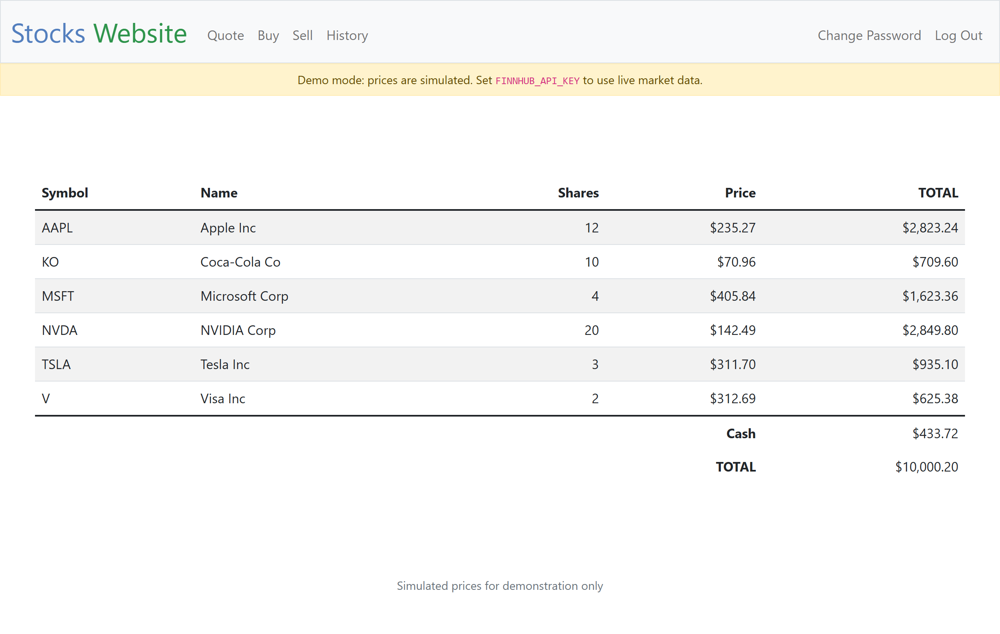
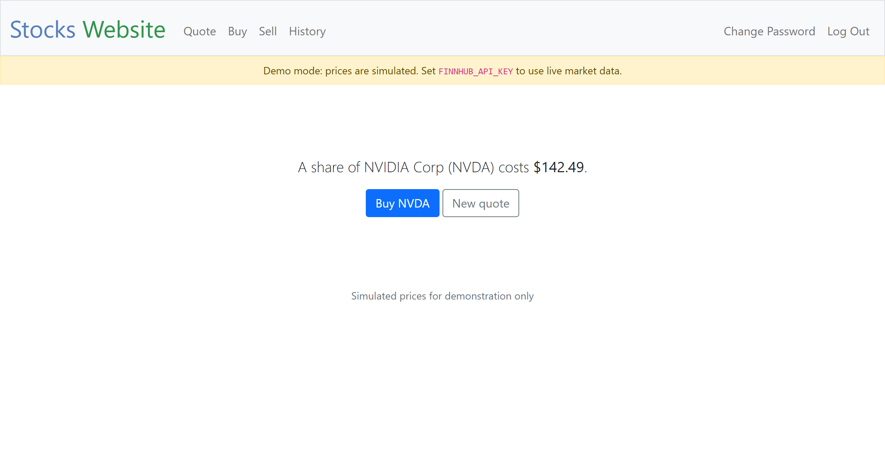
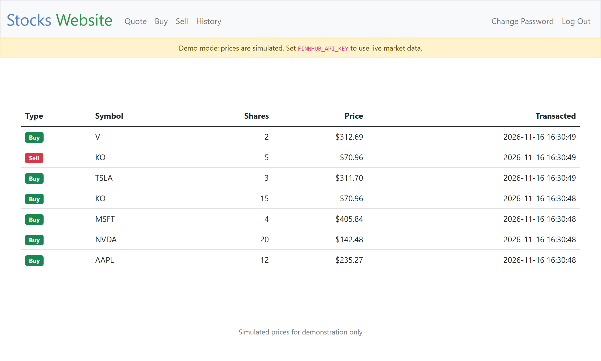

# Stocks Website

[](https://github.com/aalatraqchi/Stocks-Website/actions/workflows/ci.yml)

A stock trading simulator web app built with Python, Flask, and SQLite.

Create an account, start with $10,000 in virtual cash, look up stock quotes, and buy and sell shares while the app tracks your portfolio value and full transaction history.



> **Origin:** This project started as my solution to the *Finance* problem set in Harvard's [CS50x](https://cs50.harvard.edu/x/). CS50 provided the starter code (page layout, login/logout, and the helper functions). I wrote the trading features, and later turned it into a standalone app: the CS50 library was replaced with a small SQLite module, the retired IEX Cloud API was swapped for Finnhub, and I added a demo mode, bug fixes, and automated tests. The original assignment version is the first commit in this repository.

## Features

- **Accounts:** Register, log in, log out, and change your password. Passwords are stored as salted hashes.
- **Stock Quotes:** Look up the current price of any stock by its ticker symbol.
- **Buy & Sell:** Trade whole shares with your virtual cash, with checks for invalid symbols, share counts, insufficient funds, and overselling.
- **Portfolio:** See every position you hold with its current price and value, plus your cash balance and total net worth.
- **Transaction History:** Review every buy and sell with its price and timestamp.
- **Live or Demo Data:** Uses live quotes from Finnhub when an API key is configured, or simulated prices for 15 well-known stocks when it isn't, so the app runs with zero setup.
- **Automated Testing:** 16 tests covering accounts, trading rules, the portfolio, and the quote service.

## Tech Stack

- **Backend:** Python 3.12, Flask, Flask-Session
- **Frontend:** Jinja templates, HTML, CSS, Bootstrap 5
- **Database:** SQLite
- **Market Data:** [Finnhub](https://finnhub.io/) API
- **Testing:** pytest, GitHub Actions

## Screenshots

| Stock quote | Transaction history |
| --- | --- |
|  |  |

*Screenshots were taken in demo mode, so the prices shown are simulated.*

## Getting Started

### Prerequisites

- Python 3.10 or newer
- Optional: a free [Finnhub API key](https://finnhub.io/register) for live prices

### Install

```bash
git clone https://github.com/aalatraqchi/Stocks-Website.git
cd Stocks-Website
python -m venv .venv
```

Activate the virtual environment.

On Windows:

```powershell
.venv\Scripts\activate
```

On macOS or Linux:

```bash
source .venv/bin/activate
```

Then install the dependencies:

```bash
pip install -r requirements.txt
```

### Configure

Copy the example settings file:

```bash
cp .env.example .env
```

Then edit `.env`:

| Setting | Required | Description |
| --- | --- | --- |
| `FINNHUB_API_KEY` | No | Your Finnhub API key. Leave it blank to run in demo mode with simulated prices. |
| `SECRET_KEY` | Recommended | A random string used to sign sessions. Generate one with `python -c "import secrets; print(secrets.token_hex(32))"`. |
| `DATABASE_PATH` | No | Where to store the SQLite database. Defaults to `finance.db` in the project folder. |

`.env` is listed in `.gitignore`, so your API key stays out of version control.

### Run

```bash
flask run
```

Open http://127.0.0.1:5000, register an account, and start trading. The database and its tables are created automatically on first run from [`schema.sql`](schema.sql).

## Testing

Install the development dependencies and run the test suite:

```bash
pip install -r requirements-dev.txt
pytest
```

The tests use a temporary database and demo mode, so they never touch your data or call the Finnhub API.

## Project Structure

```text
app.py             Flask routes for accounts, quotes, trading, and history
helpers.py         Quote lookup (Finnhub or demo), login decorator, formatting
db.py              Small SQLite query helper
schema.sql         Database tables and indexes
templates/         Jinja page templates
static/            Stylesheet and favicon
tests/             pytest suite
```

## Current Scope

This is a learning project for simulated trading only. No real money or brokerage is involved. It runs as a single local Flask server with a SQLite database and doesn't include production hardening such as CSRF protection, rate limiting, or a production WSGI server. Trades are limited to whole shares at the latest quoted price, and Finnhub's free tier allows about 60 quote requests per minute.
